### Sun microsystem
- Open JDK is the main one

JDK - tools & library

JRE - gives env to run java program

JVM - place where actual java program runs

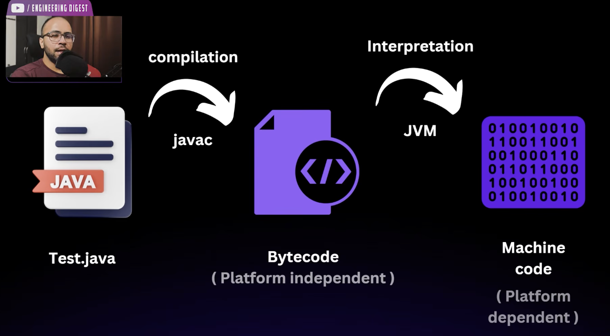

- Everything in Java should be inside the class

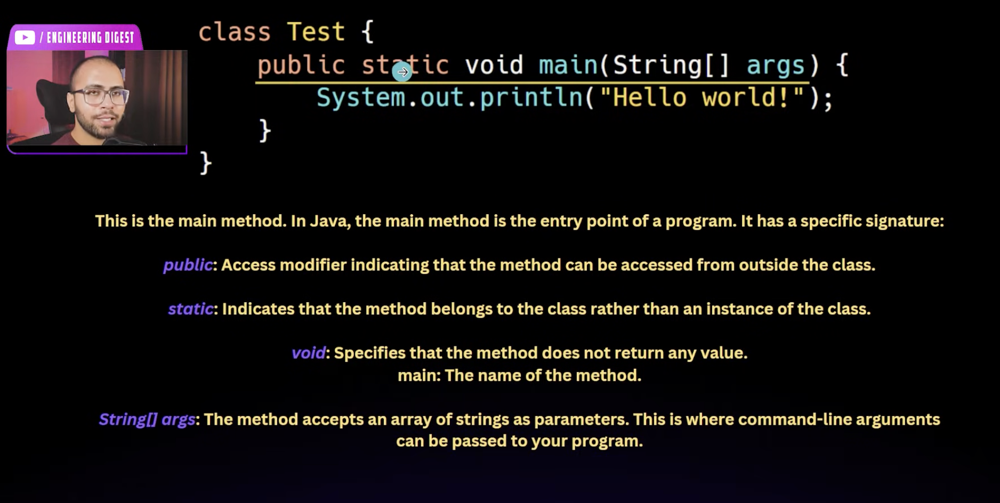

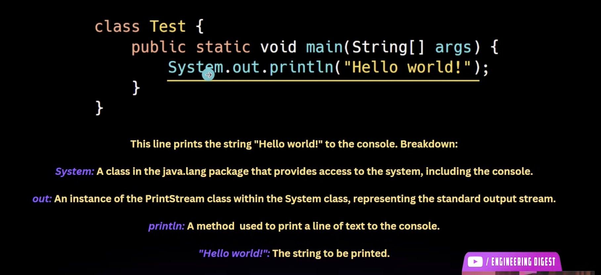


### quick learn
```java

class Test{
    public static void main(String[] args){
        System.out.println("Hello World!");
        System.out.println(args[0]);
        System.out.println(args[1]);
    }
}

/*
ekanshgupta@Ekanshs-Air Java % java Test one two
Hello World!
one
two
*/
```

## Data Types
```java
class Test{
    public static void main(String[] args){
        // Whole Numbers
            // byte     - 1
            // short    - 2
            // int      - 4
            // long     - 8

        byte a = 128;
        /*
        Test.java:9: error: incompatible types: possible lossy conversion from int to byte
            byte a = 128;
                 ^
        1 error
        */

        // -2^(n-1) -> +2^(n-1) - 1

        System.out.println(Byte.MIN_VALUE);     // -128
        System.out.println(Byte.MAX_VALUE);     // 127

        long a1 = 53453342342342;
        /*
        Test.java:22: error: integer number too large
            long a1 = 53453342342342;
                  ^
        1 error
        */
        long a1 = 53453342342342l; // 'l' is required if value is outside int range becz bydefault it consider as int

        // Decimal
            // float - 7 digit of precision
            // double
        
        float a = 323.43434423f;     // required 'f' to represent in float
        double b = 332.3423432;
        System.out.println(a);
        System.out.println(b);

        System.out.println(Float.MIN_VALUE);
        System.out.println(Float.MAX_VALUE);
        /*
        323.43436
        332.3423432
        1.4E-45
        3.4028235E38
        */

       // Character
            // char

        char c = 'a';
        System.out.println(c);
        System.out.println((int) c);
        System.out.println((int) Character.MIN_VALUE);
        System.out.println((int) Character.MAX_VALUE);
        /*
        a
        97
        0
        65535
        */

       // boolean
        boolean d = true;
        System.out.println(d);   // true

        long a = Long.MAX_VALUE;    // 01111111 11111111 11111111 11111111 11111111 11111111 11111111 11111111
        System.out.println(a);      // 9223372036854775807
        int b = (int) a;    // 11111111 11111111 11111111 11111111
        System.out.println(b);      // -1 becz of 2's complement

        System.out.println(Integer.toBinaryString(5));  // 101

        int a = 438347634;
        int b = a * 24223;
        System.out.println(b);  // 935582670
        // expected actual response is 10618094738382

        long d = a * 24223;
        System.out.println(d);  // 935582670

        long e = 438347634;
        long f = e * 24223;
        System.out.println(f);  // 10618094738382
       
        byte g = 5;
        g = g + 10;
        System.out.println(g);
        
        /*
        Test.java:4: error: incompatible types: possible lossy conversion from int to byte
            g = g + 10;
                ^
        1 error
        */

    }
}
```

## Operators
```java
class Test{
    public static void main(String[] args){
        /*
        and operator &
        or operator |
        xor ^
        not ~
        left shift <<
        right shift >>
        unsigned right shift >>>
        */

       int a = 5;
       int b = ~a;
       System.out.println(b);   // -6 becz 2's complliment
       System.out.println(Integer.toBinaryString(b));   // 11111111111111111111111111111010
       System.out.println(b>>2);    // -2
       System.out.println(b>>>2);   // 1073741822
    }
}
```

## print statement
```java
class Test{
    public static void main(String[] args){
    //    System.out.println(System.getenv());
       System.out.println("Sum" + 1 + 2);   // Sum12
       System.out.printf("%s of %d & %d = %d\n", "Sum", 1, 2, (1+2));   // Sum of 1 & 2 = 3
       System.out.printf("%s of %d & %.3f = %.2f\n", "Sum", 1, 2.3f, 1+2.3f);   // Sum of 1 & 2.300 = 3.30
    }
}
```

## String
- Immutable
```java
class Test{
    public static void main(String[] args){
        String name = "Ekansh Gupta";
        System.out.println(name);   // Ekansh Gupta
        String str1 = new String("Ekansh Gupta");
        System.out.println(str1);    // Ekansh Gupta
        String str2 = new String("Ekansh Gupta");
        System.out.println(str2);    // Ekansh Gupta

        System.out.println(str1 == str2);   // false

        String name2 = "Ekansh Gupta";

        System.out.println(name == name2);  // true

        Student std1 = new Student();
        std1.name = "Ekansh";
        std1.rollno = 1;
        std1.address = "Bewar";

        System.out.println(std1.name);  // Ekansh
    }
}
```

### String Methods
```java
class Test{
    public static void main(String[] args){
        String str1 = "Ekansh Gupta";
        System.out.println(str1.length());  // 12
        System.out.println(str1.charAt(2)); // a
        System.out.println(str1.charAt(str1.length()-1));   // a
        String str2 = "Ekansh gupta";
        System.out.println(str1.equals(str2));  // false
        System.out.println(str1.equalsIgnoreCase(str2));    // true
        System.out.println(str1.compareTo(str2));   // -32
        String str3 = "  Ekansh   ";
        System.out.println(str3.trim());    // Ekansh
        System.out.println(str1.substring(2, 5));   // ans
        System.out.println(str1.toUpperCase()); // EKANSH GUPTA
        System.out.println(str1.toLowerCase()); // ekansh gupta
        System.out.println(str1.replace("up", "xx"));   // Ekansh Gxxta
        System.out.println(str1.contains("gup"));   // false
        System.out.println(str1.startsWith("Gu"));  // false
        System.out.println(str1.endsWith("ta"));    // true
        String str4 = "   ";
        System.out.println(str4.isEmpty());   // false
        System.out.println(str4.isBlank());   // true
        System.out.println(str1.indexOf("a"));  // 2
        System.out.println(str1.lastIndexOf("a"));  // 11
        System.out.println(str1.indexOf("a", 5));   // 11

        // Specail Methods
        int a1 = 45;
        String str5 = String.valueOf(a1);
        System.out.println(str5);   // 45
        String str6 = String.format("Hii %s %d", "Everyone", 100);
        System.out.println(str6);   // Hii Everyone 100
    }
}

```

## Logical operators
```java 
class Test{
    public static void main(String[] args){
        // Relational Operators
            // < > == != 
        
        // Logical Operators
            // and &&, or ||, not !

        // Conditional

        if(1<2){
            System.out.println("if block executed");
        }
        else if(1>0){
            System.out.println("else if block executed");
        }
        else{
            System.out.println("else block executed");
        }


        // Switch Case 
        // - always use the break statement to break the flow if middle becomes true
        // - Without {} backets only allow one line statement 
        int day = 7;
        switch(day){
            case 1:{
                System.out.println("Monday");
                break;
            }
            case 2:{
                System.out.println("Tuesday");
                break;
            }
            case 3:{
                System.out.println("Wednesday");
                break;
            }
            case 4:{
                System.out.println("Thursday");
                break;
            }
            case 5:{
                System.out.println("Friday");
                break;
            }
            case 6:{
                System.out.println("Saturday");
                break;
            }
            case 7:{
                System.out.println("Sunday");
                break;
            }
            default:{
                System.out.println("Incorrect day");
            }
        }
    }
}
```

## Loops

```java
class Test{
    public static void main(String[] args){
        // While loop
        int i = 0;
        while(i<10){
            System.out.println(i);
            i++;
        }

        // do while
        do{
            System.out.println(i);
            i++;
        }while(i<10);

        // for loop
        for(int j = 0; j<10; j++){
            System.out.println(j);
        }

        // Problem-1
        /*
            1
            10
            100
            1000
            10000
            100000
        */
        for(int i=1;i<=100000;i*=10){
            System.out.println(i);
        }

        /*
            *
            **
            ***
            ****
            *****
        */
        for(int i=0;i<5;i++){
            for(int j=0;j<=i;j++){
                System.out.print('*');
            }
            System.out.println();
        }

        for(int i=0;i<10;i++){
            if(i==5) break;
            System.out.println(i);
        }

        /*
            0
            1
            2
            3
            4
        */

       for(int i=0;i<10;i++){
            if(i==5) continue;
            System.out.println(i);
        }

        /*
            0
            1
            2
            3
            4
            6
            7
            8
            9
        */

    }
}
```

## Arrays
```java
class Test{
    public static void main(String[] args){
        // - bydeafult assigned with zero value
        int[] arr = new int[10];
        arr[3] = 45;
        for(int i=0;i<arr.length;i++){
            System.out.println(arr[i]);
        }
        /*
            0
            0
            0
            45
            0
            0
            0
            0
            0
            0
        */

        int[] arr1 = {1,2,3};
        System.out.println(arr1);
        // [I@7ad041f3 --> [ = array, I = Integer, @7ad041f3 = #Code
            
        for(int i:arr1){
            System.out.println(i);
        }
        
        int[][] arr2 = new int[3][3];
        int[][] arr3 = {
            {1, 2, 3},
            {1, 2, 3},
            {1, 2, 3}
        };

        for(int i=0; i<arr3.length; i++){
            for(int j=0; j<arr3[i].length; j++){
                System.out.print(arr3[i][j]);
            }
            System.out.println();
        }
        /*
            123
            123
            123
        */

        for(int[] i:arr3){
            for(int j:i){
                System.out.print(j);
            }
            System.out.println();
        }
        /*
            123
            123
            123
        */

        int[][] zarr = new int[3][];
        zarr[0] = new int[2];
        zarr[1] = new int[3];
        zarr[2] = new int[2];
            

    }
}
```
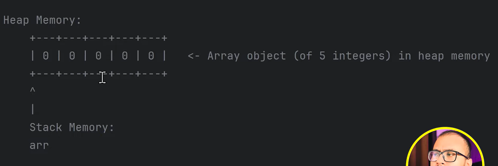
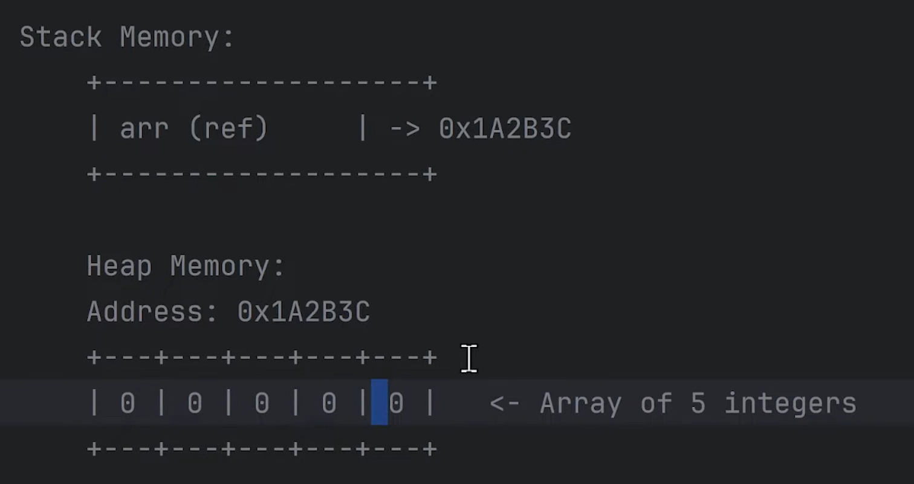

## OOP's

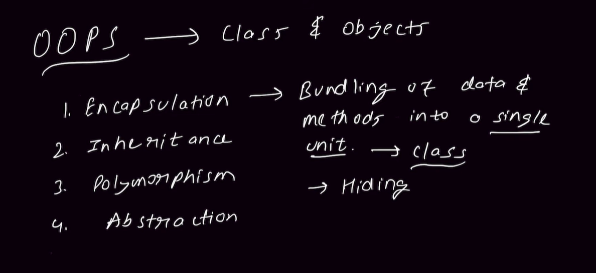

```java
public class Car{
    public String color;
    public String brand;
    public String model;
    private int year;
    private int speed;

    public int getSpeed(){
        return this.speed;
    }

    public void setSpeed(int newSpeed){
        this.speed+=newSpeed;
    }

    public void applyBreak(int applybreak){
        this.speed-=applybreak;
    }

}
```

```java

class Test{
    public static void main(String[] args){
        Car car1 = new Car();
        car1.brand = "Maruti";
        car1.model = "Road phaad denge choree";
        car1.color = "Sky blue";
        // car1.speed = 120;
        /*
            .\Test.java:8: error: speed has private access in Car
                car1.speed = 120;
                    ^
            error
        */

       car1.setSpeed(120);
       System.out.println(car1.getSpeed()); // 120
       car1.applyBreak(10);
       System.out.println(car1.getSpeed()); // 110
       
    }
}
```

```java
public class Animal{
    String name;
    int age;

    public void makeSound(){
        System.out.println("Some Sound");
    }
}
```

```java
public class Cat extends Animal{    // Inheritance
    String breed;

    public void makeSound(){
        System.out.println("Cat Sound");
    }
}
```

```java
class Test{
    public static void main(String[] args){
        Cat cat1 = new Cat();
        cat1.name = "karan";
        cat1.age = 65;
        cat1.breed = "Chutiya";
        cat1.makeSound();   // Cat Sound

        Animal cat2 = new Cat();    // Polymorphism
        cat2.makeSound();   // Cat Sound
        System.out.println(sum(2, 5));
        
    }

    public static int sum(int a, int b){
        return a+b;
    }

    public static int sum(int a, int b){    // Method overloading
        return a+b;
    }

    public static int sum(int a, int b, int c){     // Method overriding
        return a+b+c;
    }

    public static int sum(int ...a){    // Method overriding
        int sum = 0;
        for(int i: a){
            sum+=i;
        }
        return sum;
    }
}
```


## Packages

### Folder `test1`
```java
package test1;

public class Lion{
    public String name;
    public void makeSound(){
        System.out.println("Roar");
    }
}
```

### Folder `test2`
```java
package test2;

public class Lion{
    public String name;
    public void makeSound(){
        System.out.println("Roar");
    }
}
```

```java
import test1.*;
import test2.*;

class Test{
    public static void main(String[] args){
        Lion x = new Lion();
        /*
            .\Test.java:6: error: reference to Lion is ambiguous
                    Lion x = new Lion();
                    ^
            both class test2.Lion in test2 and class test1.Lion in test1 match
            .\Test.java:6: error: reference to Lion is ambiguous
                    Lion x = new Lion();
                                ^
            both class test2.Lion in test2 and class test1.Lion in test1 match
            2 errors
        */
        test1.Lion lion1 = new test1.Lion();
        lion1.name = "Ekansh";
        lion1.makeSound();
    }
}
```

## Constructor
```java
package project.test;

public class Student{
    String name;
    int age;
    int rollNumber;

    // Default constructor
    public Student(){
        this.age = 10;
    }

    // Parameterize constructor
    public Student(String name, int age, int rollNumber){
        this.name = name;
        this.age = age;
        this.rollNumber = rollNumber;
    }
}
```

```java
package project.test;

public class Test{
    public static void main(String[] args){
        Student std = new Student();
        System.out.println(std.age);   // 10
        Student std2 = new Student("Ekansh", 25, 4206);
        System.out.println(std2.name);  // Ekansh
        System.out.println(std2.age);  // 25
    }
}
```

## Inheritance deeply
- `Animal` -> `Animal.Java`
```java
package Animal;

public class Animal{
    public String name;
    public int age;

    public Animal(){
        System.out.println("Parent Constructor");
    }

}
```

- `Animal` -> `Cat.Java`
```java
package Animal;

public class Cat extends Animal{
    public String breed;

    public Cat(){
        // super(); 
        // Hidden LOS always present to call parent class constructor
        // And this statement alwasys be the first statement
        System.out.println("Child Constructor");
    }
}
```

- `MultipleInheritance` -> `Camera.java`
```java
package MultipleInheritance;

public class Camera{
    public void takePicture(){
        System.out.println("Clicking photo..");
    }

    public void powerOn(){
        System.out.println("Turning on..");
    }
}
```

- `MultipleInheritance` -> `MusicPlayer.java`
```java
package MultipleInheritance;

public class MusicPlayer{
    public void playMusic(){
        System.out.println("Playing Music..");
    }

    public void powerOn(){
        System.out.println("Turning on..");
    }
}
```

- `MultipleInheritance` -> `Phone.java`
```java
package MultipleInheritance;

public class Phone{
    public void makeCall(){
        System.out.println("Calling..");
    }

    public void powerOn(){
        System.out.println("Turning on..");
    }
}
```

- `MultipleInheritance` -> `SmartPhone.java`
```java
package MultipleInheritance;

public class SmartPhone extends Camera, Phone, MusicPlayer{

}
/*
    ./MultipleInheritance/SmartPhone.java:3: error: '{' expected
    public class SmartPhone extends Camera, Phone, MusicPlayer{
                                        ^
    1 error
*/

// Java doen't support Multiple Inheritance becz it generates ambiguity, to solve this problem support Interface
```
- `Test.java`
```java
import Animal.*;
import MultipleInheritance.*;

public class Test{
    public static void main(String[] args){
        Cat cat1 = new Cat();
        /*
            Parent Constructor
            Child Constructor
        */
    }

    SmartPhone s1 = new SmartPhone();
    // s1.powerOn();
}
```

## Static Methods
- Static Methods belongs to the class itself rather than an object (instance) of the class.

- `Student` -> `Student.java`

```java
package Student;

public class Student{
    public String name;
    public int age;
    
    public void sayHello(){
        System.out.println("Hello..!");
    }

    public static void sayBye(){
        System.out.println("bye..");
    }
}n
```

```java
import Student.*;

public class Test{
    public static void main(String[] args){
        Student std1 = new Student();
        std1.sayHello();
        std1.sayBye();
        
        Student.sayHello();
        /*
        Test.java:9: error: non-static method sayHello() cannot be referenced from a static context
                Student.sayHello();
                    ^
        1 error
        */
        Student.sayBye();   // bye..
    }
}
```

## Private Constructor
- If want there is not object of class can we created.

```java
package Student;

public class Student{
    public String name;
    public int age;
    
    private Student(){

    }

    public void sayHello(){
        System.out.println("Hello..!");
    }

    public static void sayBye(){
        System.out.println("bye..");
    }
}
```

```java
import Student.*;

public class Test{
    public static void main(String[] args){
        Student std1 = new Student();
        /*
        Test.java:5: error: Student() has private access in Student
                Student std1 = new Student();
                            ^
        1 error
        */

       Student.sayHello();
       /*
       Test.java:13: error: non-static method sayHello() cannot be referenced from a static context
            Student.sayHello();
                    ^
        1 error
       */
        
        Student.sayBye();   // bye..
    }
}
```

- If required only one object can we created of a class (also called as Singleton Patter)

```java
package Student;

public class Student{

    private static Student oneInstance;

    private Student(){

    }

    public static void getInstance(){
        if (oneInstance == null){
            oneInstance = new Student();
        }
        return oneInstance;
    }

}
```

### Important Note points
- Class can't be private
- Protected methods can only be access in extended class

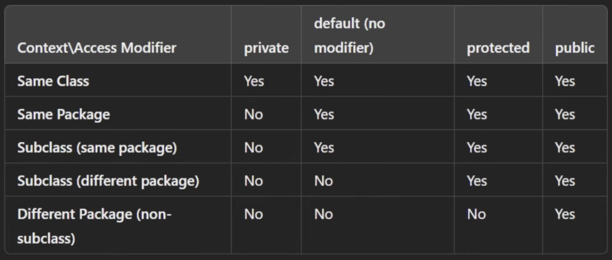

## Static Keyword
- Static keyword in java is used for Memory Management primarily.
- It can be applied on variables, methods, blocks, and nested classes.
- Static Methods cannot use non-static data members or call non-static method directly.
- `This` and `super` cannot be used in static context.

```java
package Student;

public class Student{
    // static data member
    private static int count = 0;

    // static block
    static {
        System.out.println("static block");
    }

    public Student(){
        count++;
    }

    // static method
    public static int getCount(){
        return count;
    }

}
```

```java
import Student.*;

public class Test{
    public static void main(String[] args){
        Student std1 = new Student();
        Student std2 = new Student();
        Student std3 = new Student();
        Student std4 = new Student();
        System.out.println(Student.getCount());
        /*
            static block
            4
        */
    }
}
```
## Final keyword
- `Final` data members value cannot be changed
- `Final` methods cannot be override
- `Final` classes cannot be extend

```java
package Vehicles;

public class Car{

    private final int accelerate = 200;

    public void changeSpeed(int x){
        accelerate = x;
        /*
        ./Vehicles/Car.java:8: error: cannot assign a value to final variable accelerate
                accelerate = x;
                ^
        1 error
        */
    }

    public int getSpeed(){
        return accelerate;
    }

    public final void airBags(){
        System.out.println("4 air bags..");
    }
}
```

```java
package Vehicles;

public class EvCar extends Car{
    @Override
    public void airBags(){
        System.out.println("2 air bags..");
    }
    /*
    Exception in thread "main" java.lang.IncompatibleClassChangeError: class Vehicles.EvCar overrides final method Vehicles.Car.airBags()
    */
}
```

## Interface
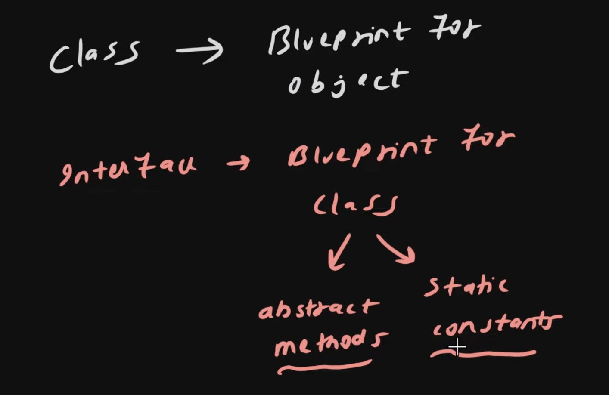

```java
package Interfaces;

public interface Animal{

    int MAX_AGE = 20;
    public abstract void eat();

    void sleep();
    // bydeafult all methods of interface are public abstract

    public void info(){
        System.out.println("info..");
    }
    /*
    ./Interfaces/Animal.java:11: error: interface abstract methods cannot have body
        public void info(){
                        ^
    2 errors
    */

    public static void info(){
        System.out.println("info..");
    }

    public default void run(){
        System.out.println("Animal is running..");
    }
}
```

```java
package Interfaces;

public class Dog implements Animal{

    public void eat(){
        System.out.println("dog is eating..");
    }

    public void sleep(){
        System.out.println("dog is sleeping..");
    }
}
```

```java
import Interfaces.*;

public class Test{
    public static void main(String[] args){
        Dog d1 = new Dog();
        d1.sleep(); // dog is sleeping..
        System.out.println(d1.MAX_AGE); // 20
        System.out.println(Animal.MAX_AGE); // 20
        Animal.info();  // info..
        Dog.info();
        /*
        Test.java:10: error: cannot find symbol
                Dog.info();
                ^
        symbol:   method info()
        location: class Dog
        1 error
        */

       d1.info();
       /*
       Test.java:19: error: cannot find symbol
            d1.info();
                ^
        symbol:   method info()
        location: variable d1 of type Dog
        1 error
       */

        Animal.run();
        /*
        Test.java:30: error: non-static method run() cannot be referenced from a static context
                Animal.run();
                    ^
        1 error
        */

        d1.run();   // Animal is running..
    }
}
```

## Multiple Inheritance

```java
package devices;

public interface Camera{
    void takePicture();
}
```

```java
package devices;

public interface MusicPlayer{
    void playMusic();
    void pauseMusic();
}
```

```java
package devices;

public interface Phone{
    void makeCall();
    void endCall();
}
```

```java
package devices;

public class SmartPhone implements Camera, MusicPlayer, Phone{
    @Override
    public void takePicture(){
        System.out.println("Take picture..");
    }

    @Override
    public void playMusic(){
        System.out.println("playMusic..");
    }

    @Override
    public void pauseMusic(){
        System.out.println("pauseMusic..");
    }

    @Override
    public void makeCall(){
        System.out.println("makeCall..");
    }

    @Override
    public void endCall(){
        System.out.println("endCall..");
    }
}
```

```java
import devices.*;

public class Test{
    public static void main(String[] args){
        SmartPhone s1 = new SmartPhone();
        s1.makeCall();  // makeCall..
        s1.takePicture();   // TakePicture..
        s1.endCall();   // endCall..
    }
}
```

## Inner Classes
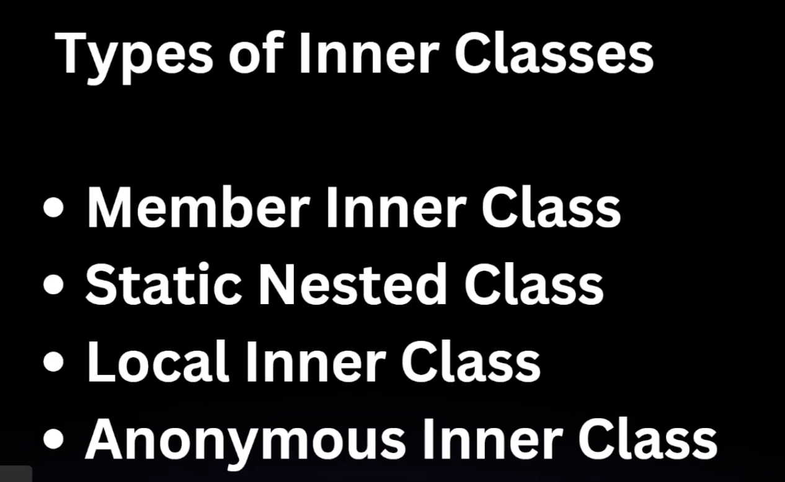

### Member Inner Class
```java
package innerClasses;

public class Car{
    private String model;
    private boolean isEngineOn;

    public Car(String model){
        this.model = model;
        this.isEngineOn = false;
    }

    public void getModel(){
        System.out.println(this.model);
    }

    public void getEngineStatus(){
        System.out.println(this.isEngineOn);
    }

    public class Engine{
        public void Start(){
            if(isEngineOn == false){
                isEngineOn = true;
                System.out.printf("%s Engine started..\n", model);
            }
            else{
                System.out.printf("%s Engine is already on..\n", model);
            }
        }
        
        public void stop(){
            if(isEngineOn == true){
                isEngineOn = false;
                System.out.printf("%s Engine stopped..\n", model);
            }
            else{
                System.out.printf("%s Engine is already off..\n", model);
            }
        }
    }
}
```

```java
import innerClasses.*;

public class Test{
    public static void main(String[] args){
        Car c1 = new Car("Range Rover");
        Car.Engine engine = c1.new Engine();
        c1.getModel();  // Range Rover
        c1.getEngineStatus();   // false
        engine.Start();     // Range Rover Engine started..
        c1.getEngineStatus();   // true
    }
}
```

### Static Nested Class
- Video no. 28 pending
```java
```
## Tyeps of ERRORS
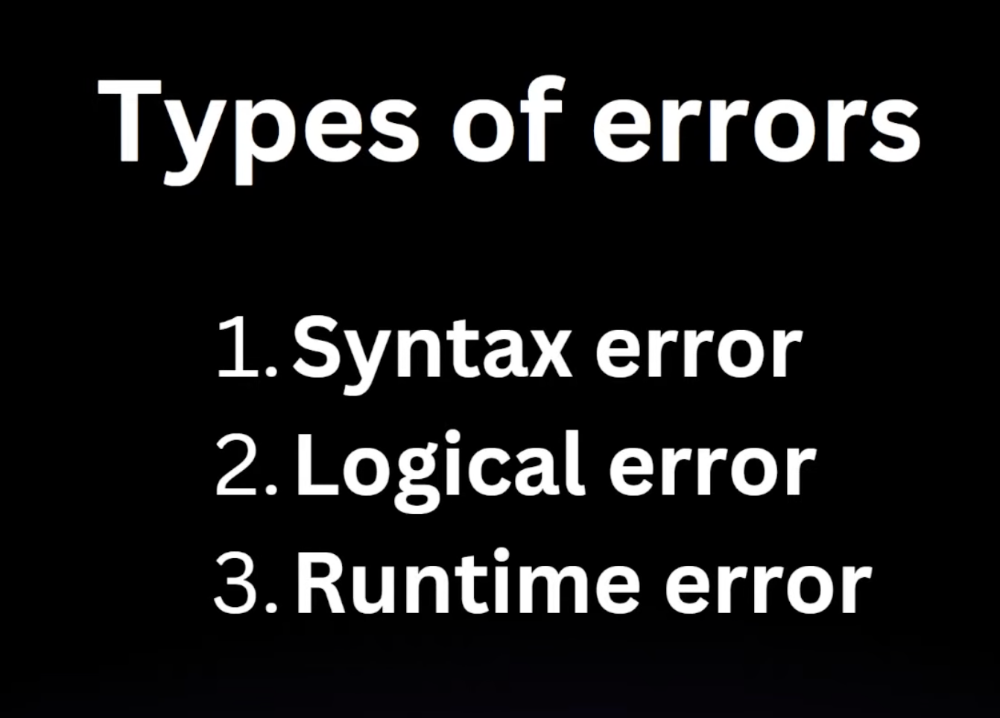


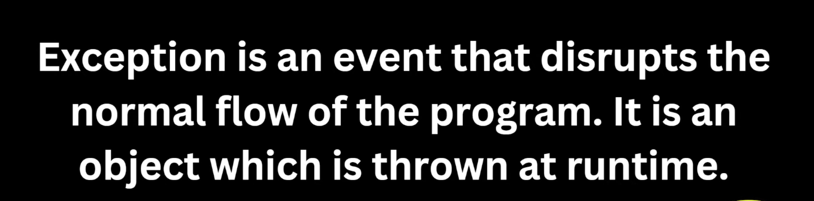

```java
public class Test{
    public static void main(String[] args){
        int[] numerators = {10, 20, 100, 30};
        int[] denomerators = {2, 3, 0, 5};
        for(int i = 0;i<numerators.length;i++){
            System.out.println(divide(numerators[i], denomerators[i]));
        }
    }

    public static int divide(int a, int b){
        try{
            return a / b;
        }catch(ArithmeticException e){
            System.out.println(e);
            return -1;
        }
    }
}

/*
    5
    6
    java.lang.ArithmeticException: / by zero
    -1
    6
*/
```

```java
public class Test{
    public static void main(String[] args){
        int[] numerators = {10, 20, 100, 30};
        int[] denomerators = {2, 3, 0, 5};
        for(int i = 0;i<numerators.length;i++){
            System.out.println(divide(numerators[i], denomerators[i]));
        }
    }

    public static int divide(int a, int b){
        try{
            return a / b;
        }catch(ArithmeticException e){
            System.out.println(e);
            return -1;
        }finally{
            System.out.println("finally block");
        }
    }
}

/*
    finally block
    5
    finally block
    6
    java.lang.ArithmeticException: / by zero
    finally block
    -1
    finally block
    6
*/
```

### Add custom exception
```java
public class BankAccount{
    private double balance;

    public BankAccount(double amount){
        this.balance = amount;
    }

    public void withdraw(double amount) throws Exception{
        if(amount < this.balance){
            this.balance-=amount;
        }
        else{
            throw new Exception("Insufficient balance..");
        }
    }

    public double checkBalance(){
        return this.balance;
    }
}
```

```java
public class Test{
    public static void main(String[] args){
        BankAccount b1 = new BankAccount(500);
        // b1.withdraw(600);
        /*
            .\Test.java:4: error: unreported exception Exception; must be caught or declared to be thrown
                    b1.withdraw(600);
                            ^
            1 error
        */
        try{
            b1.withdraw(600);
        }catch(Exception e){
            System.out.println(e);
        }
        System.out.println(b1.checkBalance());
        /*
            java.lang.Exception: Insufficient balance..
            500.0
        */

    }
}
```

### Create Custom Exceptions

```java
public class InsufficientFundsException extends Exception{
    public InsufficientFundsException(){
        super("Insufficient balance");
    }
}
```

```java
public class BankAccount{
    private double balance;

    public BankAccount(double amount){
        this.balance = amount;
    }

    public void withdraw(double amount) throws InsufficientFundsException{
        if(amount < this.balance){
            this.balance-=amount;
        }
        else{
            throw new InsufficientFundsException();
        }
    }

    public double checkBalance(){
        return this.balance;
    }
}
```

```java
public class Test{
    public static void main(String[] args){
        BankAccount b1 = new BankAccount(500);
        // b1.withdraw(600);
        /*
            .\Test.java:4: error: unreported exception Exception; must be caught or declared to be thrown
                    b1.withdraw(600);
                            ^
            1 error
        */
        try{
            b1.withdraw(600);
        }catch(Exception e){
            System.out.println(e);
        }
        System.out.println(b1.checkBalance());
        /*
            InsufficientFundsException: Insufficient balance
            500.0
        */

    }
}
```

## Wrapper Classes
- Wrapper classes convert primitive data types into objects

```java
public class Test{
    public static void main(String[] args){
        int a = 1;  // Premitive variable -> stores in Stack memory
        // Integer b = Integer.valueOf(1); // Autoboxing bydefault can be directly write 
        Integer b = 1;  // Reference variable -> uses stack memory
        int x = b;  // Autounboxing
        Float c = 4.5f;
        Double d = 43.12;
        Boolean e = true;
        Character f = 'a';
        Byte g = 23;
        Short h = 3;
        Long i = 322l;

        System.out.println(Integer.max(2, 4));  // 4
        System.out.println(Integer.min(2, 4));  // 2
        System.out.println(Integer.toBinaryString(5));  // 101
        String str = "3423";
        Integer strInt = Integer.valueOf(str);
    }
}
```

## MATH Library

```java
public class Test{
    public static void main(String[] args){
        int a = 5;
        int b = 7;
        System.out.println(Math.max(a, b));     // 7
        System.out.println(Math.min(a, b));     // 5
        System.out.println(Math.ceil(1.2));     // 2.0
        System.out.println(Math.floor(1.2));    // 1.0
        System.out.println(Math.abs(-11));      // 11
        System.out.println(Math.round(1.2));    // 1
        System.out.println(Math.sqrt(25));      // 5.0
        System.out.println(Math.pow(3, 4));     // 81.0
        System.out.println(Math.log10(100));    // 2.0
        System.out.println(Math.log(5));    // 1.6094379...
        System.out.println(Math.PI);    // 3.141592653589793
        System.out.println((int) (Math.random() * 10));
        System.out.println(Math.PI);
        System.out.println(Math.PI);
    }
}
```
## ENUM
- Used where need to define multiple constants
```java
public class Test{
    public static void main(String[] args){
        System.out.println(Day.MONDAY);     // MONDAY
        Day monday = Day.MONDAY;
        System.out.println(monday.ordinal());   // 0 index of MONDAY
        System.out.println(monday.name());      // MONDAY
        System.out.println(monday);     // MONDAY

        Day day = Day.MONDAY;
        String res = switch(day){
            case MONDAY -> "M";
            case TUESDAY -> "T";
            default -> "X";
        };
        System.out.println(res);    // M
    }
}
```

## Generic classes
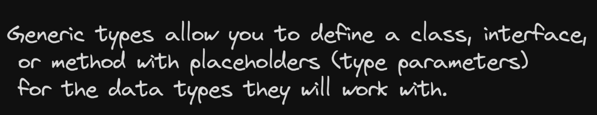
```java
public class Box<T>{
    private T value;

    public T getValue(){
        return this.value;
    }

    public void setValue(T x){
        this.value = x;
    }
}
```

```java
public class Pair<K, V>{
    
    private K key;

    private V value;

    public Pair(K key, V value){
        this.key = key;
        this.value = value;
    }

    public K getKey(){
        return this.key;
    }

    public V getValue(){
        return this.value;
    }
}
```

```java
public class Test{
    public static void main(String[] args){
        Box<Integer> b1 = new Box<>();
        b1.setValue(43);
        System.out.println(b1.getValue());  // 43

        Pair<String, Integer> p1 = new Pair<>("key", 24);
        System.out.printf("%s -> %d \n", p1.getKey(), p1.getValue());   // key -> 24 
    }
}
```

### Bounded condition
```java
public class Box<T extends Number>{
    private T value;

    public T getValue(){
        return this.value;
    }

    public void setValue(T x){
        this.value = x;
    }
}
```

```java
public class Test{
    public static void main(String[] args){
        Box<String> b1 = new Box<>();

        /*
            Test.java:3: error: type argument String is not within bounds of type-variable T
                    Box<String> b1 = new Box<>();
                        ^
            where T is a type-variable:
                T extends Number declared in class Box
        */
    }
}
```

## Generic constructor of Normal class
```java
public class Box{

    public <T extends Number> Box(T x){
        System.out.println("Generic construtor " + x);
    }

    public <T> void display(T message){
        System.out.println("Generic method " + message);
    }

}
```

```java
public class Test{
    public static void main(String[] args){
        Box b1 = new Box(45.4);     // Generic construtor 45
        b1.display("Hii");  // Generic method Hii
    }
}
```
## Collection

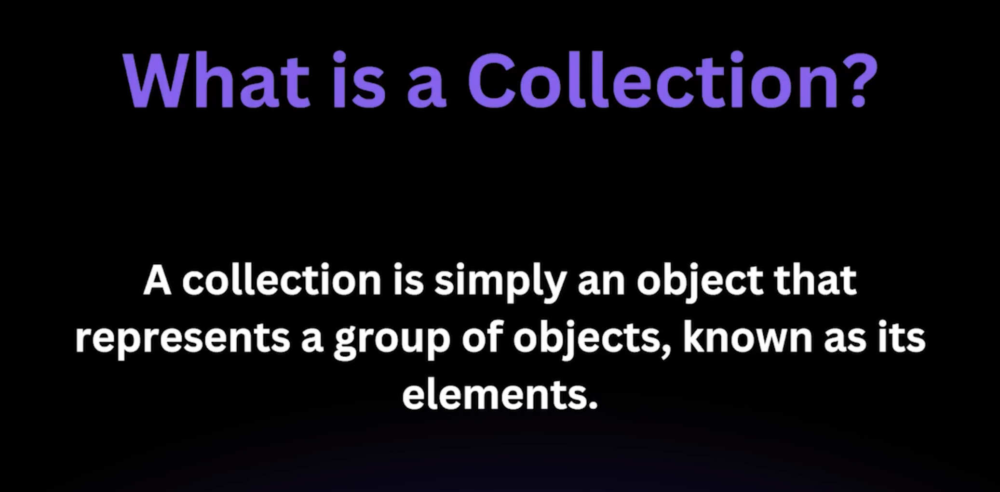
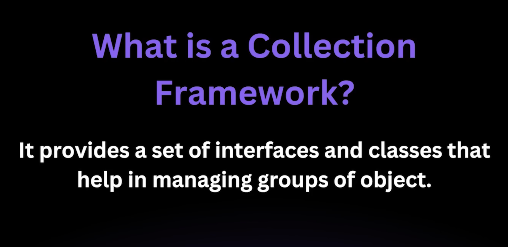
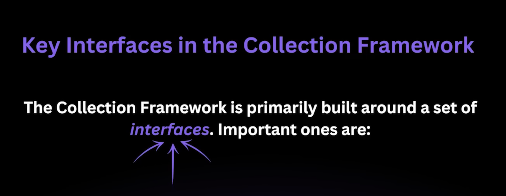

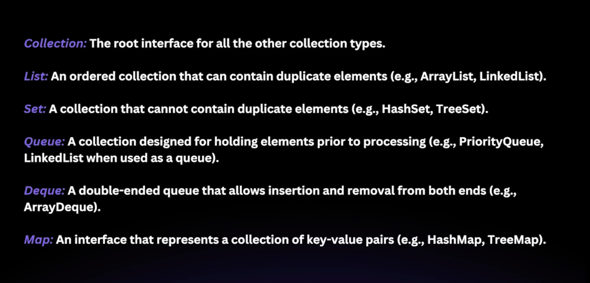

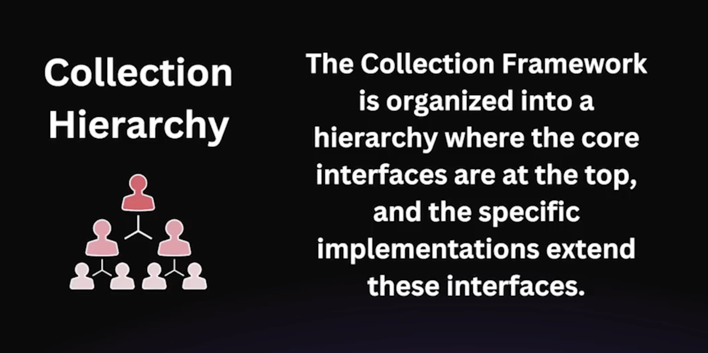

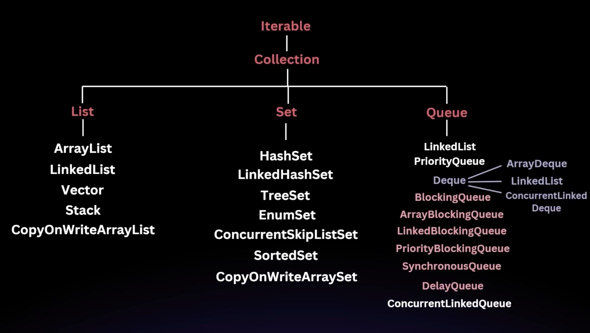

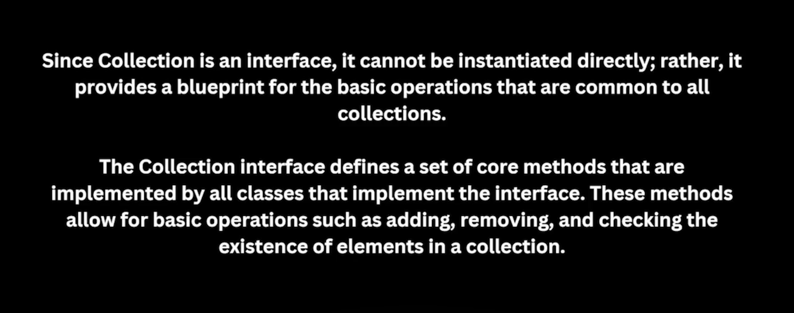

### List
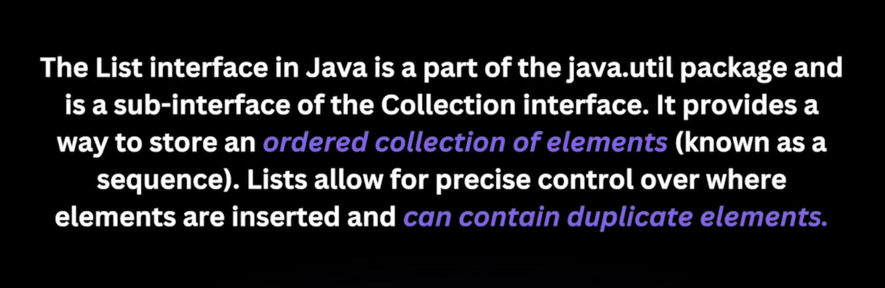


### ArrayList

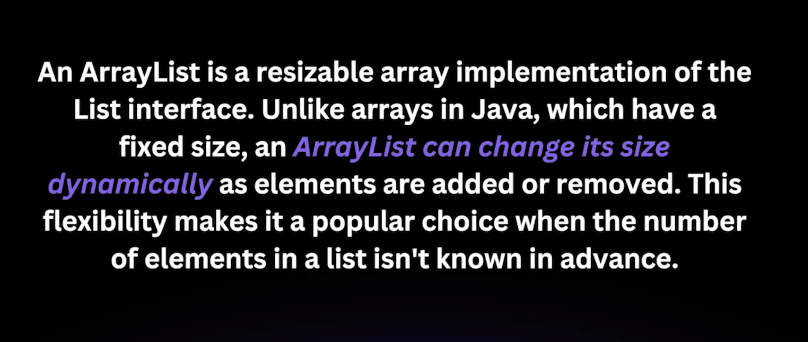


```java
import java.util.ArrayList;
import java.util.List;
import java.util.Arrays;

public class Test{
    public static void main(String[] args){
        ArrayList<Integer> a1 = new ArrayList<Integer>();
        a1.add(4);
        a1.add(23);
        a1.add(80);
        System.out.println(a1.get(1));  // 23
        System.out.println(a1.size());  // 3
        for(Integer i: a1){
            System.out.println(i);
        }
        /*
            4
            23
            28
        */
       System.out.println(a1.contains(34)); // false
       a1.remove(1);    // [4, 80]
       a1.add(1, 44);   // [4, 44, 80]
       a1.set(1, 33);   // [4, 33, 80]
       System.out.println(a1);

       List<Integer> l1 = Arrays.asList(12, 43, 25);
       System.out.println(l1.getClass().getName());     // java.util.Arrays$ArrayList
       System.out.println(a1.getClass().getName());     // java.util.ArrayList
       // No add or remove allowed

       l1.set(2, 99);
       System.out.println(l1);  // [12, 43, 99]

       List<Integer> l2 = List.of(1,2,3,4);     // Unmodifiable list
    //    l2.set(2, 88);   // Raise ERROR

       // To make list modifiable
       ArrayList<Integer> a2 = new ArrayList<>(l2);
       a2.add(75);
       System.out.println(a2);      // [1, 2, 3, 4, 75]

        a2.remove(Integer.valueOf(1));
        System.out.println(a2);     // [2, 3, 4, 75]

    }
}
```
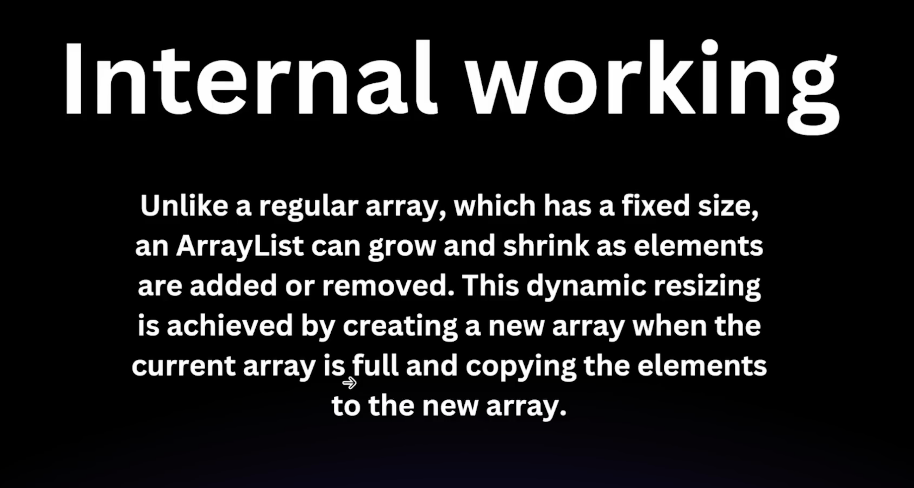
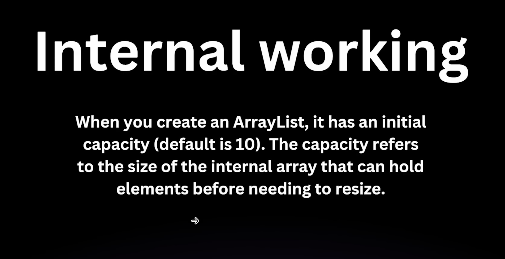
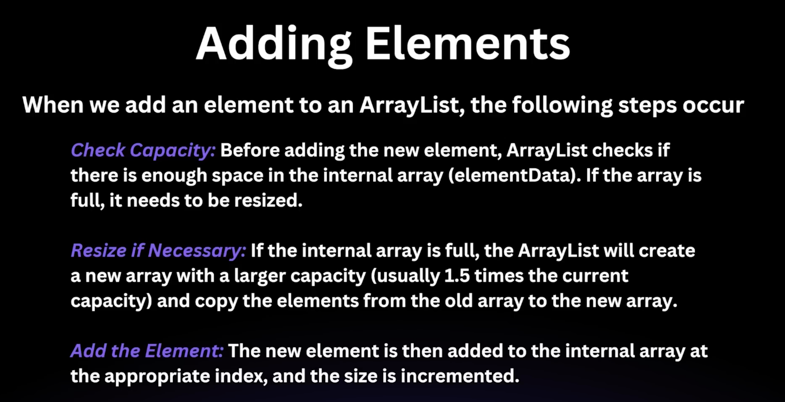
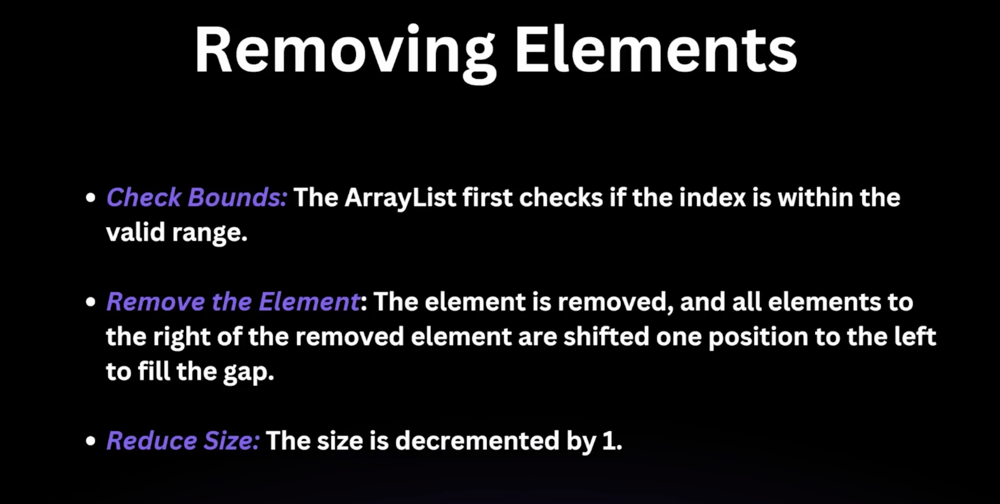
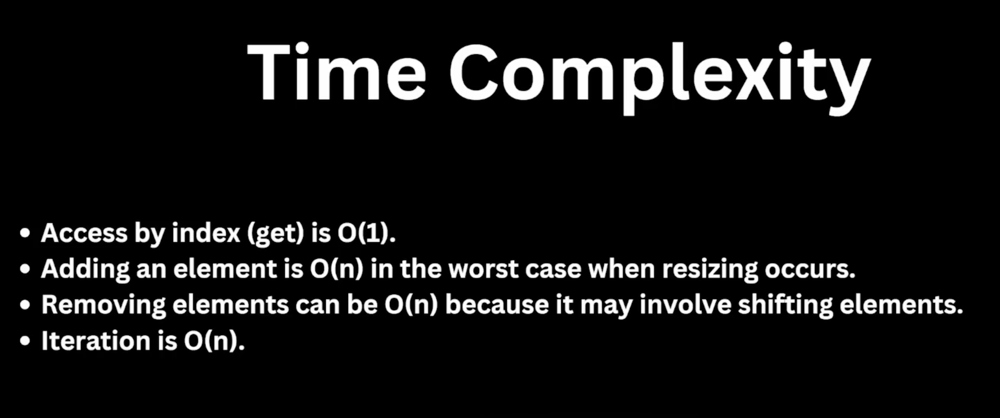

### Comparator
```java
import java.util.ArrayList;
import java.util.List;
import java.util.Arrays;
import java.util.Comparator;

class MyComparator implements Comparator<Integer>{

    @Override
    public int compare(Integer o1, Integer o2){
        return o2 - o1;
    }
    /*
    return -1 -> o1 is 1st
    return 0 -> o1 == o2
    return 1 -> o2 is 1st
    */
}

class MyStringComparator implements Comparator<String>{

    @Override
    public int compare(String o1, String o2){
        return o1.length() - o2.length();
    }
}

class Student{
    private String name;
    private double gpa;

    public Student(String name, double gpa){
        this.name = name;
        this.gpa = gpa;
    }

    public String getName(){
        return this.name;
    }

    public double getGpa(){
        return this.gpa;
    }
}

class StudentComparator implements Comparator<Student>{

    @Override
    public int compare(Student s1, Student s2){
        if( s1.getGpa() - s2.getGpa() < 0 ) return 1;
        else if( s1.getGpa() - s2.getGpa() > 0 ) return -1;
        else return 0;
    }
}

public class Test{
    public static void main(String[] args){
        List<Integer> a1 = new ArrayList<>();
        a1.add(32);
        a1.add(21);
        a1.add(43);

        a1.sort(null);      // [21, 32, 43]
        a1.sort(new MyComparator());    // [43, 32, 21]

        List<String> a2 = Arrays.asList("banana", "apple", "date");
        a2.sort(null);      // [apple, banana, date]
        a2.sort(new MyStringComparator());      // [date, apple, banana]
        
        // also can we done using lambda expression

        a2.sort((a, b) -> b.length() - a.length());     // [banana, apple, date]

        List<Student> s1 = new ArrayList<>();
        s1.add(new Student("Ekansh", 8.5));
        s1.add(new Student("Tanu", 9.7));
        s1.add(new Student("Pari", 8.1));

        s1.sort(new StudentComparator());

        for(Student i: s1){
            System.out.printf("%s -> %f \n", i.getName(), i.getGpa());
        }
        /*
            Tanu -> 9.700000 
            Ekansh -> 8.500000 
            Pari -> 8.100000 
        */

    }
}
```

```java
```

```java
```

```java
```

```java
```

```java
```


```java
```

```java
```

```java
```

```java
```

```java
```

```java
```

```java
```

```java
```


```java
```

```java
```

```java
```

```java
```

```java
```

```java
```

```java
```

```java
```